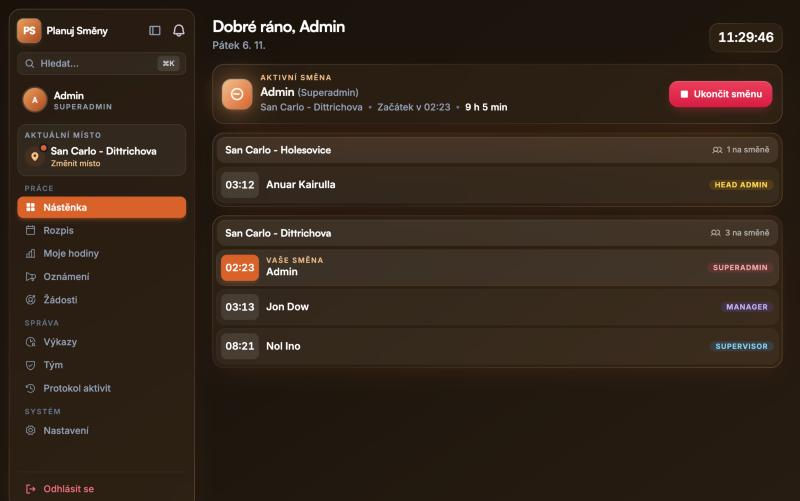
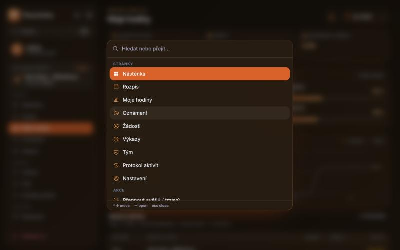
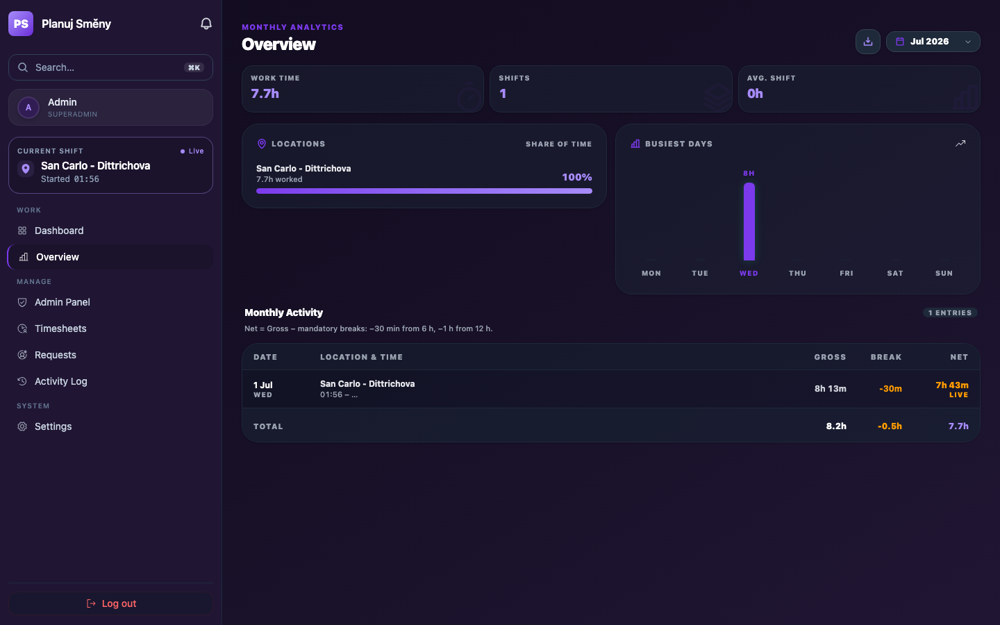
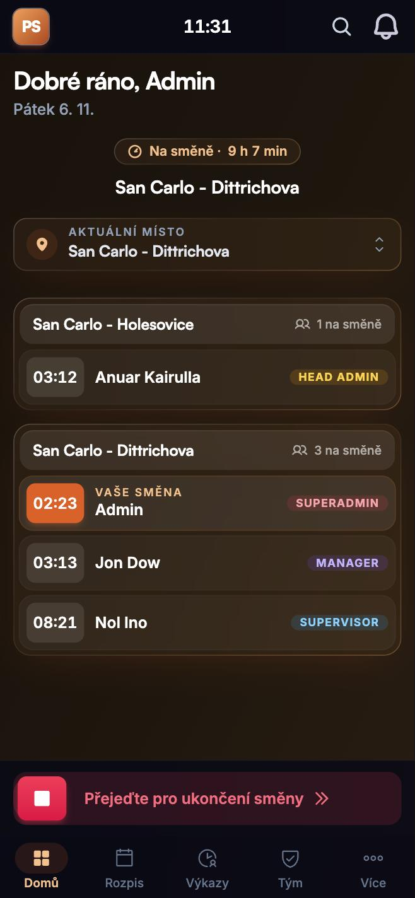
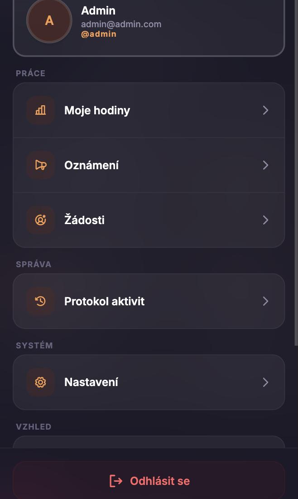

# Planuj Směny

A modern, cross-platform **shift-planning and time-tracking** app for Czech
teams. An owner signs up and creates their organization; people clock in and out
by location in real time, confirm and swap their planned shifts; admins plan the
rota, decide requests and post announcements — each with exactly the rights
their (custom) role gives them. On the web or as a native Android/iOS app.

> **Status: active development (beta).** Features and UI change frequently.
> _Version 1.11.0 — “Cheb” · last updated: November 7, 2026._ · See the [Roadmap](ROADMAP.md).

---

## 📸 Screenshots

| Dashboard | Command palette (⌘K) |
| :--: | :--: |
|  |  |

| Overview — dark, Violet motif | Mobile (home · More) |
| :--: | :--: |
|  |   |

---

## ✨ Features

### Shift tracking
- **Clock in / out by location**, with mid-shift location switching and a
  confirm/switch popup.
- **Live board** — see who's on shift right now, updating instantly via Supabase
  Realtime (with automatic reconnect). The board shows only locations with
  activity, so it scales with the team, not the location count.
- **Auto-end at midnight** — shifts left open overnight are closed automatically
  at Europe/Prague midnight by a scheduled job.

### Scheduling (rota)
- **Two views of one rota:** a **roster grid** (people × days, paper-rota style —
  the default) split into 1–15 / 16–end print bands, and a **month calendar per
  location**. Admins tap a cell (grid) or a day (calendar) to assign staff.
- **Day editor** — assign several people at once, per-member times or an all-day
  mark; anyone already busy elsewhere that day is locked, and the database
  rejects overlapping assignments so nobody is double-booked.
- **Planning tools:** per-location **staff rosters**, restaurant **short/long-week
  quick-fill** (replaces, doesn't stack), clear a person / location / whole month,
  **copy last month**, **My Team** self-service (take & release members), person
  search, admin-set **location letters** shown in cells, and a Σ hours column.
- **Draft → publish** — new assignments are drafts only the planner sees; one
  **Publish** flips the month live for members and notifies everyone involved.
- **Time off** (vacation / sick / other): members request, admins approve or
  decline in Requests (or enter pre-approved leave); approved leave **clears the
  rota** for those days and blocks planning, and overlapping leave per person is
  rejected.
- **Reminders:** if someone hasn't clocked in, **late-for-shift alerts** fire at
  +15 min and +1 h to the member and their manager (pg_cron, every 5 min).
- **Exports mirror the on-screen view** — the grid exports as a people × days
  matrix (PDF in two print bands / Excel), the calendar as month pages.
- A **next-shift card** on the dashboard, and today's rostered location
  preselects your clock-in.
- **Fast grid editing** — pick a template in the brush bar and tap empty cells to
  paint shifts; tap an existing shift to remove it, with **Undo** in the toast.
- **Shift templates** — save a time once ("09:00–17:30") and reuse it in the grid
  and the day editor; up to 8 per organization.
- **Shift confirmations** — members tick their upcoming shifts (select all →
  Confirm). A confirmation is final for the member and resets automatically when
  an admin changes that shift.
- **Availability** — members mark days they can't work; the grid hatches them and
  the editor warns before you plan someone there.
- **Coverage targets** — set how many people a location needs per weekday; days
  below target get a dot in the grid.
- **Open shifts** — post an unassigned shift; members claim it (or give it back);
  an admin adds it to the rota in one tap.
- **Czech public holidays** are marked in the rota. Working on a holiday is
  allowed; the app warns once (with "don't show again").
- **Location opening hours** — a location's hours are its default shift: the
  location letter in the grid means "the whole opening time", and planning
  outside the hours is flagged.
- **Rest rules (Czech labour law)** — the grid warns when someone gets less than
  11 h between two shifts or works more than 6 days in a row.
- **Shift swaps** — a member offers an upcoming shift (to anyone or one
  colleague), a teammate who is free takes it, and someone with the right to
  decide approves it in Requests; the shift then moves to the taker.

### Timesheets & analytics
- **My hours** (Overview, per member): this month's plan (worked vs. planned
  shifts), an hours-through-the-month chart with last month for comparison,
  totals and averages, with **mandatory-break math** baked in (−30 min for every
  started 6 h, per Czech labour law).
- **Timesheets**: managers view a member's month; admins also add, edit and
  delete shifts, with an overnight-shift-aware time picker.
- **Exports** as **PDF / Excel / CSV**, per employee or the whole team; on native
  they open the OS **share sheet**, on web they download.
- **Activity Log**: an append-only record of **every action** in the app —
  clock-ins and -outs, the rota, requests and decisions, swaps, announcements,
  open shifts, templates, availability, wages (who changed whose rate, never the
  amount), locations and their hours, roles and permissions, invites and
  removals. Filter by person or by group (Shifts, Rota, Requests, Team, Roles,
  Announcements, Locations).
- Months are bucketed by the viewer's **local** calendar month (no UTC-boundary
  surprises).

### Sign-up & admin
- **Owner sign-up** — anyone can create an account (email + password) together
  with a brand-new organization and becomes its Head Admin. Invited members
  still join an existing organization through their invite.
- **Admin Panel** for Organizations (Superadmin), Locations and Team: create /
  edit / delete, with search. An empty organization can be deleted.
- **Hourly wages** are set by people with the Wages right (for people below
  them, never themselves) and feed a pay estimate.
- **Invite by email, with a role** — new members are provisioned into the right
  organization and role atomically, finishing onboarding on a branded
  `/accept-invite` page.

### Custom roles (Discord-style)
- **Roles your way** — the Head Admin creates roles with any name and colour and
  ticks **view / change / delete** per area: rota, timesheets, requests,
  announcements, team, wages, locations, activity log and roles.
- **The order is the hierarchy** — move roles up and down; you manage only people
  and roles below your own, and can hand out only the rights you hold yourself.
- **Presets to start from** (Employee, Supervisor, Manager, Admin, Head Admin) —
  editable, or used as a template for a new role. Head Admin always stays on top
  with every right.
- **A default role for everyone** — "Employee" sits at the bottom and its rights
  add to every member's own role. Deleting a role moves its people there.
- Everything is enforced in the database (RLS, triggers, checked RPCs), not just
  the UI.

### Requests
- **One inbox for every request** — time off (vacation / sick / other), name
  changes, shift swaps, **role requests**, any **other request**, and
  **complaints**, with *To review*, *History* and *My requests* tabs.
- **New request** form: ask for a role (approving applies it at once — only
  someone allowed to give that role can), write any other request, or file a
  complaint, **optionally anonymous** (reviewers never see the sender; the
  activity log and pushes don't either).
- **Four eyes**: approve, or decline with a reason the member sees. Nobody
  decides on their own request — not even the Head Admin; your own pending
  requests show in the queue without buttons. Approving leave warns first when it
  would remove planned shifts. People with view-only access see the queue
  read-only; complaints only reach those who can decide them.
- Members track every decision and can withdraw a pending request. **Username**
  is self-service but rate-limited to once every 7 days.

### Announcements
- Admins post, pin, edit and delete notices for the whole team. New posts arrive
  as a push notification and an unread badge; the latest unread one shows on
  Home.

### Notifications
- **In-app bell** — a personal feed of what concerns you: your schedule being
  published / changed / removed, time-off and request decisions, swaps, new
  requests to review, late-shift alerts, name-change decisions, announcements,
  and edits to your profile or role.
- **Push notifications** (Firebase Cloud Messaging, native): the same events,
  delivered to your device, with **per-category preferences** (master switch +
  shift / account / requests) in Settings. Tapping opens the relevant screen —
  or the notifications panel when there's no dedicated one.
- Everything also lands in the **Activity Log** for people with that right.

### Navigation
- **Command palette** (**⌘K / Ctrl K**) to jump to any page or location.
- Sticky, collapsible sidebar grouped by section + a searchable location picker
  with recent posts.
- **Role-aware mobile tab bar** — staff get Home · Schedule · My hours ·
  Announcements · More; managers and admins get Home · Schedule · Timesheets ·
  Team · More.

### Localization & theming
- **English / Čeština** throughout, with a 12h/24h time-format option and
  locale-aware dates.
- **Premium glass design** — frosted surfaces, compact type, one consistent set of
  components on every page.
- **Colour schemes** (Lilac / Emerald / Cyan / Amber / Violet) + **Light / Dark /
  System** themes, with native status-bar sync.

### Mobile (Capacitor)
- Native-style bottom tab bar + a "More" control center (grouped nav, quick
  theme/language, app version).
- **Pull-to-refresh**, **haptics**, **skeleton** loading states, and the Android
  **hardware back button** dismisses open overlays before navigating.
- Safe-area handling, splash/keyboard/status-bar plugins, native share, and
  push notifications.
- **PWA-ready** — installable from the browser (Add to Home Screen).

---

## 🛠 Tech stack

| Layer | Tech |
| --- | --- |
| Frontend | React 19 + TypeScript, Vite 7 |
| Routing / state | React Router 7, TanStack Query 5 |
| Styling / motion | Tailwind CSS v4, Framer Motion, Phosphor icons |
| i18n | Custom lightweight `t()` + EN/CS dictionaries |
| Validation | Zod |
| Reports | jsPDF + jspdf-autotable, SheetJS (xlsx, lazy-loaded) |
| Backend | Supabase — Postgres, Auth, Realtime, Edge Functions, pg_cron |
| Native | Capacitor 8 (Android & iOS) — push, share, filesystem, haptics, keyboard, splash, status-bar |
| Tooling | ESLint 9, Prettier, Vitest, Yarn 4 (Corepack) |

---

## 🧱 Architecture

```
src/
├─ app/            # shell, layout (AppShell, Sidebar, BottomNav), command palette,
│                  # navigation config, providers, router guards
├─ features/
│  ├─ auth/        # login, accept-invite, AuthContext, route guards
│  ├─ shifts/      # clock in/out, realtime, Overview + export
│  ├─ schedule/    # rota: roster grid + calendar, day editor, time off, exports
│  ├─ locations/   # location picker (recent + search), confirm/switch popup
│  ├─ timesheets/  # admin shift management, exports, Activity Log
│  ├─ admin/       # Admin Panel: orgs / locations / team
│  ├─ roles/       # custom roles: list + hierarchy, editor, permission matrix
│  ├─ requests/    # Requests inbox: time off, names, swaps, role/other/complaints
│  ├─ announcements/# team announcements, read state, home banner
│  ├─ availability/# "can't work" days
│  ├─ wages/       # hourly rates (admin-only) + pay estimate
│  ├─ notifications/# in-app bell + push registration + preferences
│  ├─ profile/     # profile editing
│  └─ settings/    # appearance, language, time format, notifications
└─ shared/         # api client, types (zod), i18n, UI components, hooks, utils
supabase/
├─ migrations/     # SQL schema, RLS policies, triggers, cron
├─ functions/      # Edge Functions (Deno)
└─ tests/          # rls_smoke.sql — org isolation + request rules (rolled back)
```

### Roles & permissions

Each organization has its own **roles** (`org_roles`), ordered top to bottom:
the order is the hierarchy (Head Admin is always 40 at the top, the default
Employee role always 0 at the bottom). A role carries **view / change / delete**
per area (`org_role_permissions`). A member's rights are their own role's plus
the default role's; Head Admin and Superadmin hold everything.

| Preset | Starts with |
| --- | --- |
| Head Admin | Everything, incl. roles and locations (locked) |
| Admin | Change rota, timesheets, requests, announcements, team, wages; view locations + activity |
| Manager | View rota, timesheets, requests, team, announcements |
| Supervisor | Nothing beyond the default role |
| Employee (default) | Own shifts, own requests, clock in/out — its rights add to everyone's |

The UI asks for a **capability** (`can(user, 'rota.edit')` in
`src/shared/auth/permissions.ts`, read from the role's matrix); the database
enforces the same rule with `has_permission(area, action)` in **RLS policies,
triggers and checked RPCs**, so it holds even for direct API calls. Managing
only people and roles below your own, handing out only rights you hold, no
self-escalation, four-eyes request decisions and org scoping are enforced the
same way.

### Edge Functions (`supabase/functions/`)
- **`invite-employee`** — invites a user and provisions org + (custom) role;
  logs who invited whom.
- **`delete-employee`** — removes a member with permission + hierarchy checks;
  logged.
- **`username-login`** — resolves a username to an email for sign-in.
- **`delete-account`** — GDPR self-service account deletion; the organization
  keeps a log entry.
- **`send-push`** — sends FCM (HTTP v1) pushes from Database Webhooks
  (`shift_audit_log`, `name_change_requests`, `announcements`), localized per
  recipient (EN/CS) and honouring per-user preferences. Schedule and time-off
  notifications flow through the `shift_audit_log` webhook (rows are written by
  SECURITY DEFINER triggers / the publish RPC).

---

## 📦 Getting started

Uses **Yarn (Berry v4, via Corepack)** — single lockfile (`yarn.lock`); version
pinned in `package.json` (`packageManager`). Don't add `package-lock.json`.

```bash
corepack enable          # once (ships with Node 18+)
yarn install
cp .env.example .env      # then fill in the values below
yarn dev                 # Vite dev server, exposed on your LAN (--host)
```

### Environment variables
| Variable | Description |
| --- | --- |
| `VITE_SUPABASE_URL` | Supabase project URL, e.g. `https://<ref>.supabase.co` |
| `VITE_SUPABASE_PUBLISHABLE_KEY` | Supabase publishable (anon) key. **Never** ship the `service_role` key to the client. |

The displayed app version is injected from `package.json` at build time.

### Local Supabase
```bash
supabase start            # boot local stack (Docker)
supabase db reset         # apply migrations + seed (supabase/seed.sql)
supabase functions serve  # run Edge Functions locally
```

### Build for native
```bash
yarn build
npx cap sync
npx cap open android   # or: npx cap open ios
```

### Push notifications (native)
Push requires Firebase (FCM). In short: create a Firebase project, add the
Android app (`com.planujsmeny.app`), drop `google-services.json` into
`android/app/` (gitignored), then deploy the function and wire the webhooks:
```bash
supabase secrets set FCM_SERVICE_ACCOUNT="$(cat service-account.json)"
supabase functions deploy send-push --no-verify-jwt
```
Create Database Webhooks (INSERT) on `shift_audit_log`, `name_change_requests`
and `announcements` pointing at the `send-push` function. Keep the Firebase
**service-account key out of git** (it's ignored).

---

## 🧰 Scripts
| Script | What it does |
| --- | --- |
| `yarn dev` | Vite dev server (LAN-exposed) |
| `yarn build` | Type-check + production build (`tsc -b && vite build`) |
| `yarn typecheck` | Type-check only |
| `yarn lint` | ESLint |
| `yarn format` | Prettier write — run it on the files you touch, not the whole repo |
| `yarn test` / `test:watch` | Vitest (run / watch) |

Database checks: `supabase/tests/rls_smoke.sql` proves organization isolation,
no self-promotion and the four-eyes rule in a transaction that is rolled back —
run it against **preprod** (SQL editor, or `psql -f`).

---

## 🚢 Deployment

- **Hosting:** Vercel. `master` → **production**; `dev` / `preview` → preview
  deployments. SPA rewrites are configured in `vercel.json`.
- **Database:** two Supabase projects — **prod** and **preprod** — kept in sync
  via the migrations in `supabase/migrations/`. CI (`verify`) runs lint, tests
  and the build on every PR.
- **Versioning:** semver tags (`vX.Y.Z`) + GitHub Releases per release. Notable
  releases also carry a **codename** — a Czech town, advancing A→Z
  (v1.9.0 = _Adamov_, v1.10.0 = _Beroun_, v1.11.0 = _Cheb_).
- **Scheduled jobs (pg_cron):** auto-end open shifts at Europe/Prague midnight;
  late-for-shift alerts every 5 minutes.

---

## 🔒 Security

- **Row Level Security** on every table; organization isolation + the role
  hierarchy are the source of truth (UI only mirrors them).
- Keep the `service_role` key and the Firebase **service-account key**
  server-side only (Edge Function secrets); both are gitignored.
- Don't ship default demo credentials to any shared environment — rotate the
  seeded admin's password and pick a non-obvious username first.

---

_Created by Anuar Kairulla._
